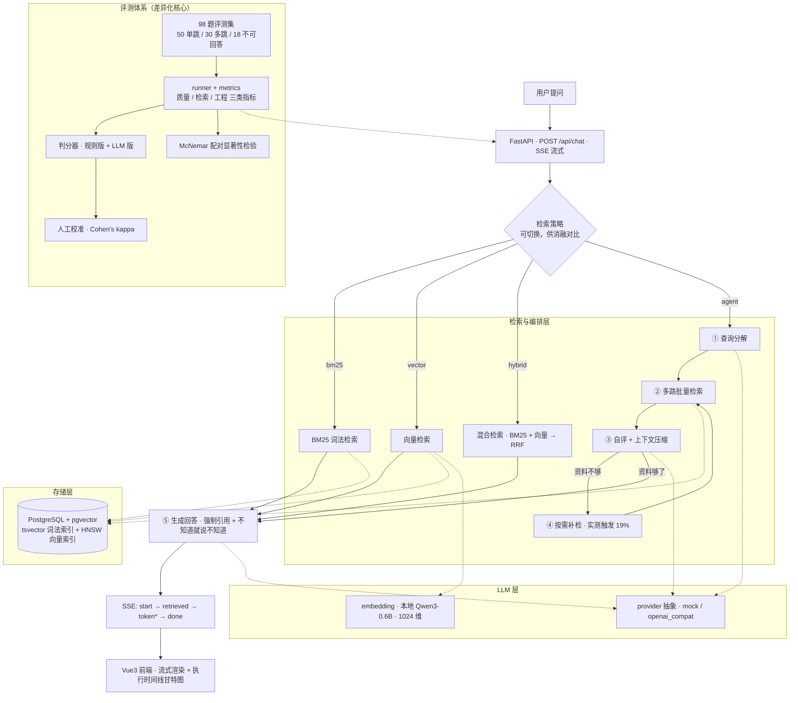

# Agentic RAG —— 会自我纠错的知识库问答 Agent

> 一个把「检索一次就作答」升级为
> `问题分解 → 混合检索 → 相关性自评 → 失败回退重检索 → 上下文压缩 → 作答 → 引用溯源`
> 的知识库问答 Agent，配有**自建评测集、消融实验与统计显著性检验**。
>
> 📄 [检索踩坑记录](docs/RETRIEVAL_NOTES.md)
> · [评测踩坑记录](docs/EVAL_NOTES.md)

---

## 结果速览

**98 道自建评测题 · 68 篇 Vue 3 官方文档 / 1,919 个运行时片段 · LLM 判分器有人工作一致性评估**

> 片段数口径：知识库入库默认 `chunk_size=300 / overlap=60`，当前语料得到 1,919 块；
> 评测题生成器使用 `800 / 120` 切块得到 700 块（见 `qa_v1.stats.json`）。评测 gold 保存原文片段，
> 不绑定这两种切块结果，因此二者服务于不同步骤，数字不应混作同一索引规模。

| 配置 | 可回答题正确率 | **幻觉率** | **多跳正确率** | 片段召回@5 | token |
|---|---|---|---|---|---|
| 裸模型（不接检索） | 0.6125 | **1.0** | 0.60 | — | — |
| ① BM25 单通道 | 0.575 | 0.0556 | 0.20 | 0.7125 | 626 |
| ② + 向量 / RRF 融合 | 0.65 | 0.0556 | 0.30 | 0.7438 | 618 |
| ③ + 查询分解 | 0.75 | 0.1111 | 0.5667 | 0.8438 | 868 |
| ④ + 上下文压缩 | 0.75 | **0.0** | 0.60 | 0.8187 | 498 |
| ⑤ + 提示词改进 | **0.85** | 0.0556 | **0.7333** | 0.8313 | 672 |
| ⑥ + 合并自评与压缩 | 0.8375 | 0.0556 | 0.7333 | **0.8375** | **567** |

第⑤和⑥行的原始 JSON 报告已归档到 [`backend/eval/benchmarks/`](backend/eval/benchmarks/README.md)。
第⑤行使用不可回答题重判后的数据；第⑥行来自 2026-10-08 的完整评测报告。

**三个最该记住的数字：**

- **幻觉率 100% → 0%** —— 18 道"语料里没有答案"的题，裸模型一道都没拒答（全部编造）
- **多跳正确率 0.20 → 0.7333** —— 中间经历过"加了 RAG 反而掉到 0.20"的谷底
- **延迟 P50 3633 ms / P95 5540 ms**（第⑥行配置，本机实测；98 次请求）

> ⚠️ **98 道题只能分辨约 0.10~0.14 的正确率差异**，小于此的对比都在读噪声。
> 配对检验用的 McNemar（`eval/significance.py`），不是独立双样本 ——
> 详见 [评测踩坑记录](docs/EVAL_NOTES.md) 第十三章。
>
> LLM 判分器与人工标签在 31 条样本上的 Cohen's κ：第⑤行原始评测为 0.3487，
> 第⑥行为 0.2821，当前一致性偏低。因此表中质量分数是探索性结果，不能当成人工金标准；
> 旧版 32 条样本 κ=0.616 的结果不能代表当前判分器表现。

---

## 架构



**关键设计取舍：**

| 决策 | 为什么 |
|---|---|
| **自实现 Agent 编排**，不用 LangChain AgentExecutor | 需要可控的 trace span、预算控制、证据去重；框架抽象在这些点上插不进去（约 400 行） |
| **gold 用原文片段，不绑 chunk id** | 换分块策略时不用重新标注评测集，消融实验才做得下去 |
| **判断"检索命中"用文本覆盖度** | 同上：让同一份评测集能评测任意分块策略 |
| **本地 embedding（ONNX，无 PyTorch）** | 不花钱、不联网、数据不出机器；代价是 CPU 推理慢（入库 1919 片段 766 秒） |
| **trace 自己实现（JSONL span）** | 能精确到"第几次检索的哪一路捞到了哪块"，是后续所有性能优化的基础 |

---

## 当前进度

**① 对话链路（已完成）**

- [x] FastAPI 后端 + SSE 流式 `/api/chat`
- [x] LLM 提供方抽象（`mock` / `openai_compat`，无 Key 自动回退 mock）
- [x] 真流式输出（实测 `分片数 / token 数 = 1.00`，证明是真流式而非假流式）
- [x] trace：`trace_id` / 分阶段耗时 / token 用量，随 `done` 事件下发
- [x] Vue3 前端：边收边渲染 + Trace 面板（耗时条 / token 统计）

**② 检索链路（已完成）**

- [x] 数据层：文档切块 → jieba 分词 → 写入 PostgreSQL（幂等，重复入库不重复）
- [x] **中文全文检索修复**：`content_seg` 生成列 + GIN 索引（详见踩坑记录）
- [x] BM25 检索：自实现（TF × IDF × 长度归一化），纯 Python，无第三方检索库
- [x] 检索接进对话 `app/rag.py`：检索 → 拼提示词 → 生成 → **引用标注**
- [x] 语料换成真实文档：Vue 3 官方中文文档（68 篇 / 1,919 个片段）

**③ 评测体系（已完成）**

- [x] 评测集数据模型（gold 以**原文片段**为准，不绑 chunk id）
- [x] 合成流程：实体索引 → 单跳 / 多跳 / 不可回答
- [x] **多跳题三道自动校验**：证据定位 + 可解答性 + 必要性
- [x] Runner：并发执行 + 三类指标（质量 / 检索 / 工程）
- [x] 判分器：规则版 + LLM 版 + 人工校准（Cohen's kappa）
- [x] 三种被测系统：`oracle`（评测器自检）/ `bare`（消融第 0 行）/ `http`（真实后端）

**④ 混合检索与查询分解（已完成）**

- [x] 向量通道：本地中文 embedding（Qwen3-Embedding-0.6B / 1024 维），不依赖外部 API
- [x] RRF 融合：`mode=bm25/vector/hybrid` 可切换，一组参数跑出三行消融数据
- [x] 查询分解：`app/planner.py` —— 分解 → 多路检索 → 自评 → 按需补检
- [x] 上下文压缩：`app/compress.py` —— 只留相关原文句，token 降 43%
- [x] **完整消融链**：BM25 → 混合(小模型) → 混合(Qwen3) → +查询分解 → +压缩 → +改进提示词

**⑤ 评测可信度（已完成）**

- [x] 显著性检验：`eval/significance.py`（McNemar 配对检验）
- [x] 量化评测集的分辨力：98 道题只能分辨约 0.10~0.14 的正确率差异
- [x] **判分器一致性评估**：保留早期 κ=0.616 结果，同时发现最新 v12/v13 的 κ 降至 0.3487 / 0.2821；当前质量分数按探索性结果呈现
- [x] **修判分器**：把"给出具体答案"和"编造"区分开；14 份历史报告统一重判（只变 4 条）
- [x] `eval/rejudge.py`：改了度量之后能只重判、不重跑系统

**⑥ 性能（已完成）**

- [x] 批量向量化：多路子查询合成一批推理，受控 A/B **1.96x**
- [x] 合并「自评」和「上下文压缩」：省一次 LLM 往返，受控 A/B **省 1269ms**
- [x] 模型缓存移到项目内（`backend/.models`）—— 之前落在 `%TEMP%` 会被系统清理
- [x] `/api/health` 带 `code_version` —— 防止在旧代码上做实验

**⑦ 前端 Trace 可视化（已完成）**

- [x] **执行时间线（甘特图）**：每个阶段的起止时刻、串行/并行、父子嵌套
- [x] 增量式 `start_ms`：后端只多记一个计时点，前端据此画图
- [x] 上下文压缩可视化：10 块 → 3 块、2996 字 → 533 字、省 82%
- [x] 检索策略切换器：界面上直接切换 BM25 / 向量 / 混合 / Agent，当场对比 trace 与答案
- [x] 检索结果展示 + 压缩统计

**⑧ 交付物（已完成）**

- [x] README：结果速览表 + mermaid 架构图 + 目录结构校正 + 可追溯评测快照
- [x] `scripts/smoke_test.py`：14 项协议断言，可直接进 CI

**⑨ 可选加分项**

- [ ] **rerank 精排**：对候选集用专门模型重新打分，压住"恰好含一个词"的假命中
      （补上消融表计划中的一行）
- [x] **引用编号检查**：检查生成答案引用的 `[n]` 是否存在于本次上下文，并提示无引用答案
      （只校验编号结构，不证明引用在语义上支持结论；逐句语义核验仍待实现）
- [ ] 写一份可操作的判定 rubric 后重新标注，把 kappa 从 0.616 提到 0.8 以上

> **关于 kappa 是否受判分器修正影响**：已实测验证 —— **不受影响，仍是 0.6157**。
> 判分器的修正只改了"不可回答题"的规则，而校准样本来自的 `v9-ccomp-k10`
> 幻觉率本来就是 0（18 道全部正确拒答），重判后 0 条变化。

---

## 快速开始

### 前置

- Python 3.11+（当前环境为 3.14.7）
- Node.js 18+（当前环境为 22.19.0）
- Docker：**Week 1 才需要**，Week 0 不依赖

### 1. 后端

```powershell
cd backend

# 建虚拟环境并装依赖
python -m venv .venv
.venv\Scripts\python -m pip install -U pip
.venv\Scripts\python -m pip install -r requirements.txt

# 配置（可选：不配也能跑，会走 mock 模式）
Copy-Item .env.example .env
#   然后编辑 .env 填入 LLM_API_KEY

# 启动
.venv\Scripts\python run.py
```

启动后：

- API 文档 <http://127.0.0.1:8000/docs>
- 健康检查 <http://127.0.0.1:8000/api/health>

> **没有 API Key 也能跑。** `LLM_PROVIDER=auto` 时若检测不到 Key，会自动回退到
> `MockProvider`，用假模型流式吐字。这样新环境 clone 下来立刻能验证
> SSE / 前端渲染 / trace 这条工程链路，不受网络和额度干扰。

### 2. 前端

```powershell
cd frontend
npm.cmd install
npm.cmd run dev
```

打开 <http://localhost:5173>，发一句话，右侧 Trace 面板会显示**执行时间线**。

> **两个 Windows 上的坑**（都实测踩过）：
>
> 1. **用 `npm.cmd` 而不是 `npm`。** PowerShell 会把 `npm` 解析到 `npm.ps1`，
>    参数被吃掉，报 `Unknown command: "pm"` 这种看不懂的错。
> 2. **必须用 `localhost` 而不是 `127.0.0.1`。** Vite 默认只绑 IPv6（`::1`），
>    写 `127.0.0.1:5173` 会连不上。要看绑定在哪个地址：
>    `Get-NetTCPConnection -LocalPort 5173 -State Listen`

**界面上能切换检索策略**（BM25 / 向量 / 混合 / Agent）——切换后 Trace 时间线和
答案都会变，可以直接对比：

| 切换 | 你会看到 |
|---|---|
| BM25 | 时间线只有一段检索，多跳问题经常答不出来 |
| 向量 | 同样是单段，但换个说法的问题能命中 |
| 混合 | 两路融合，`retrieve.hybrid` 的耗时变长 |
| **Agent** | 冒出 `planner.decompose` / `planner.assess+compress`，多跳问题答得出来，但延迟明显变高 |


### 3. 冒烟测试（不开浏览器验证 SSE 链路）

```powershell
cd backend
.venv\Scripts\python scripts\smoke_test.py
```

预期输出：

```
[ok] /api/health  模式=MOCK（未配置 API Key）  provider=auto  model=deepseek-chat
[ok] 事件序列 = start -> token -> token -> ... -> done
[ok] 收到 N 个 token 分片，共 M 字
[PASS] SSE 链路正常：start -> token -> done，且 token 是逐块到达的。
```

### 4. 评测框架自检

评测器本身必须先被验证，否则你无法区分「系统变差了」和「评测器写错了」。
第 1、2 条命令**不需要任何 API Key**：

```powershell
cd backend

# 1) 生成种子评测集并自动校验（所有 gold 片段必须能在原文中逐字定位）
.venv\Scripts\python -m eval.seed
.venv\Scripts\python -m eval.validate --dataset eval\datasets\qa_seed.jsonl --raw corpus\raw --strict

# 2) 喂标准答案给评测器 → 各项指标应当全部为 1.0，否则是评测器写错了
.venv\Scripts\python -m eval.run_eval --system oracle --tag selftest

# 3) 基线：纯 LLM 不接检索 → 可回答题正确率 0，幻觉率 1.0
.venv\Scripts\python -m eval.run_eval --system bare --tag baseline

# 4) 端到端（需要后端已启动）
.venv\Scripts\python -m eval.run_eval --system http --tag e2e

# 5) 扩到 100 条评测集（需要真实 API Key）
.venv\Scripts\python -m eval.generate --single 50 --multi 30 --unanswerable 20
```

报告同时输出 JSON 与 Markdown：

```
eval/reports/selftest__oracle__rule__20260920T034906Z.md
eval/reports/selftest__oracle__rule__20260920T034906Z.json
```

---

## 评测体系

### 为什么先建评测（而不是先写检索）

没有评测集时，"我优化了 RAG"这句话在实际使用中一句都站不住：
你无法证明改动有效，也无法发现"改了 A 结果 B 退化了"。
所以顺序必须是 **建尺子 → 量基线 → 再优化**。

### 一个关键设计：gold 用原文片段，不绑 chunk id

`schema.py` 里 `EvalItem.gold_spans` 存的是**文档中逐字出现的原文片段**，
而不是 chunk id。检索是否命中通过文本覆盖度（`eval/text.py: is_covered`）判定。

这样做换来的是：**同一份评测集可以评测任意分块策略**。
否则第 3 周做「固定切分 vs 语义分块 vs 父子块」的消融实验时，
每换一种分块都要重新标注一遍评测集，实验根本做不下去。

### 三类问题，三种验证方式

| 类型 | 生成方式 | 关键验证（防止指标失真） |
|---|---|---|
| 单跳 50 条 | 针对单个片段出事实题 | evidence 必须能**定位回原文**，否则丢弃 |
| 多跳 30 条 | 先建实体共现索引，再对共享实体的**跨文档**片段对出桥接题 | 两段 evidence 都要能定位回原文 |
| 不可回答 20 条 | 把真实问题里的关键实体替换成"合理但语料中不存在"的实体 | 替换后的实体必须**确实不在**语料里 |

最后一条是幻觉率能否成立的前提：如果替换出的实体碰巧语料里有，
这道题就变成可回答的了，幻觉率会虚高。

### 指标分三层

| 层 | 指标 | 回答什么问题 |
|---|---|---|
| 质量 | `accuracy` / `answer_accuracy` / `refusal_accuracy` / **`hallucination_rate`** | 产品能不能用 |
| 检索 | `span_recall@k` / `hit_rate@k` / `MRR` / `nDCG@k` | 问题出在检索层还是生成层 |
| 工程 | `latency_p50/p95` / `tokens_per_item` / `cost_total` | 能不能上线、成本多少 |

`hallucination_rate` 只在"不可回答"题上统计，定义是**该拒答却没拒答的比例**。

### 判分器：规则版 + LLM 版 + 人工校准

- `RuleBasedJudge`：字符 bigram 相似度，零成本、完全确定。
  **它只用来验证评测框架能跑通，数值不能对外。**
- `LLMJudge`：真实指标来源。
- **人工校准**：抽 20~30 条人工标注（格式见 `eval/datasets/human_labels.example.jsonl`；
  实际标注文件 `human_labels.jsonl` 属于"答案纸"，不进版本库），
  计算 judge 与人工的一致率与 Cohen's kappa。

只报 judge 给出的分数、却不验证 judge 本身可不可信，
是评测里最常见的方法论漏洞——报告里必须主动交代。

### 三种被测系统

| 系统 | 用途 |
|---|---|
| `oracle` | 直接返回标准答案。**不是基线，是评测器自检**：喂标准答案都不到满分，说明判分器或指标写错了 |
| `bare` | 纯 LLM 不接检索，消融表的第 0 行，也是幻觉率的上界 |
| `http` | 调用后端 `/api/chat`，真实端到端 |

---

## SSE 协议

`POST /api/chat`

```jsonc
// 请求
{ "messages": [ { "role": "user", "content": "什么是 RAG？" } ], "system": null }
```

响应为 `text/event-stream`，事件序列固定为 `start → (retrieved) → token* → (error) → done`：

| 事件 | 载荷 | 状态 |
|---|---|---|
| `start` | `{ trace_id, provider, model }` | 已实现 |
| `retrieved` | `{ chunks: [{ chunk_id, doc_id, text, score }] }` | **Week 1 实现**，评测器已提前支持解析 |
| `token` | `{ text }` | 已实现 |
| `error` | `{ message, retryable }` | 已实现 |
| `done` | `{ trace_id, duration_ms, usage, spans[] }` | 已实现 |

`retrieved` 是评测检索指标（`span_recall@k` / `MRR` / `nDCG`）的唯一数据来源。
它一旦下发，报告里的检索指标会自动开始有数，评测代码一行都不用改。

前端刻意**不用 `EventSource`**——它只支持 GET，而聊天必须 POST 对话历史。
因此改为 `fetch` + `ReadableStream` 手动解析 SSE 分帧，见
`frontend/src/api/client.ts`。

---

## 目录结构

```
.
├── docs/
│   ├── RETRIEVAL_NOTES.md   # 检索踩坑记录（中文分词四个坑 / BM25 的边界 / 缓存被清）
│   └── EVAL_NOTES.md        # ★ 评测踩坑记录（14 章：指标 bug / 多跳校验 / 显著性 / kappa）
├── docker-compose.yml       # pgvector(pg16) + adminer
├── backend/
│   ├── app/
│   │   ├── main.py          # ★ 应用入口：CORS / SSE 事件流 / trace 组装 / code_version
│   │   ├── config.py        # pydantic-settings，环境变量 / .env
│   │   ├── rag.py           # ★ RAG 准备阶段：检索（+压缩）→ 拼提示词；含 timed() 埋点
│   │   ├── planner.py       # ★ 查询分解 + 相关性自评（Agent 的"决策"部分）
│   │   ├── compress.py      # ★ 上下文压缩；assess_and_compress 合并版也在这里
│   │   ├── hybrid.py        # ★ BM25 + 向量 → RRF 融合（含加权 RRF、多路合并）
│   │   ├── bm25.py          # BM25 自实现（TF × IDF × 长度归一化）
│   │   ├── vector.py        # pgvector 向量检索（含批量 search_many）
│   │   ├── embedding.py     # 本地 embedding（Qwen3-0.6B / ONNX）+ 模型/维度自检
│   │   ├── segment.py       # jieba 分词（入库侧 precise / 查询侧 cut_for_search）
│   │   ├── corpus.py        # 文档加载与切块
│   │   ├── ingest.py        # 入库：切块 → 分词 → 向量化 → 幂等写入
│   │   ├── db.py            # psycopg 连接
│   │   ├── jsoncall.py      # 让模型稳定返回 JSON（提示词 + 多候选提取 + 重试）
│   │   └── llm/             # ★ 提供方抽象：provider / mock / openai_compat / factory
│   ├── corpus/raw/          # 语料：Vue 3 官方中文文档（68 篇 / 1919 片段）
│   ├── .models/             # 本地 embedding 模型（2.3GB，gitignore）
│   ├── eval/                # ★ 评测框架（差异化核心）
│   │   ├── schema.py        # 数据模型：gold 用原文片段而非 chunk id
│   │   ├── text.py          # 中文匹配：字符 n-gram / 覆盖度 / 原文定位
│   │   ├── corpus.py        # 语料加载与分块（与检索栈解耦）
│   │   ├── generate.py      # 合成评测集：实体索引 → 单跳 / 多跳 / 不可回答
│   │   ├── validate.py      # 评测集校验（gold 片段能否逐字定位、doc_id 是否失效）
│   │   ├── systems.py       # 被测系统：oracle（自检）/ bare（消融第 0 行）/ http
│   │   ├── judges.py        # 规则判分器 + LLM 判分器 + Cohen's kappa
│   │   ├── metrics.py       # 质量 / 检索 / 工程 三层指标
│   │   ├── runner.py        # 并发执行
│   │   ├── significance.py  # ★ McNemar 配对显著性检验（判断改动是否真的有效）
│   │   ├── calibration.py   # ★ 生成盲标工作表 + 用已有报告算 kappa
│   │   ├── rejudge.py       # ★ 只重判、不重跑系统（改了判分器时用）
│   │   ├── report.py        # JSON + Markdown 报告
│   │   ├── run_eval.py      # ★ 评测入口 CLI
│   │   ├── datasets/        # 评测集、人工标注、校准工作表
│   │   └── reports/         # 评测报告产物（已 gitignore）
│   ├── db/init/001_init.sql # documents / chunks 建表（GIN 词法索引 + HNSW 向量索引）
│   ├── scripts/smoke_test.py # 端到端冒烟：断言 SSE 协议契约 + 代码版本一致性
│   └── requirements.txt
└── frontend/
    └── src/
        ├── App.vue                      # 顶栏 + 检索策略切换器
        ├── api/client.ts                # SSE 手动分帧解析
        ├── composables/useChat.ts       # 对话状态机（含配置持久化）
        ├── components/ChatPanel.vue
        ├── components/TracePanel.vue    # 统计 + 压缩率 + 检索结果
        └── components/TraceTimeline.vue # ★ 执行时间线（甘特图）
```

★ = 核心模块，建议优先阅读。

---

## 四个刻意的工程决策

1. **LLM 提供方抽象成接口**（`app/llm/provider.py`）
   业务层不依赖任何厂商 SDK。后面换模型、做 A/B、加语义缓存，都只改这一层。

2. **Trace 自己写，不用现成框架**（`app/tracing/tracer.py`）
   Week 2 的「回退重检索」分支需要记录每次回退的原因和当时拿到的证据，
   通用框架很难插进去。落盘格式自己定，评测脚本可直接读 trace 做聚合。
   之后要接 Langfuse，只需在这一个文件加 exporter。

3. **评测集的 gold 用原文片段，不绑 chunk id**（`eval/schema.py`）
   换来的是同一份评测集可以评测任意分块策略，Week 3 的消融实验才做得下去。

4. **无 Key 也能跑通全链路**（`app/llm/mock.py` + `--system oracle`）
   mock 让链路验证不受网络与额度干扰；`oracle` 让评测器本身可自检。
   一个不能被验证的评测器，比没有评测器更危险——它会给你虚假的信心。

---

## 常见问题

**Q：前端报「后端未连接」？**
先确认后端已启动，且 <http://127.0.0.1:8000/api/health> 能打开。

**Q：回答等了很久才一次性出现，没有流式效果？**
说明中间有东西在缓冲。已做的处理：后端发了 `X-Accel-Buffering: no`；
前端默认**直连** 8000 端口而非走 Vite 代理。若你自行加了 nginx，需在其配置里
对该路径关闭 `proxy_buffering`。

**Q：开流时报 400 且提示 `stream_options` 不支持？**
把 `backend/.env` 里的 `LLM_INCLUDE_USAGE` 改成 `false`
（代价是拿不到精确 token 统计）。

**Q：trace 文件在哪？**
`backend/var/traces/YYYY-MM-DD.jsonl`，每行一个完整请求记录。
也可以直接调 `GET /api/traces/recent?limit=20` 看内存里的最近记录。

**Q：评测报告里的数字可以直接对外用吗？**
只有当 `判分器 = llm` 且报告里有 kappa 时才可以用。
用 `rule` 判分器跑出来的数字只能用于验证评测框架，报告顶部会自动打警告。

**Q：`--system oracle` 分数不是 1.0 怎么办？**
说明评测器有 bug，先修评测器，不要去看被测系统。
常见原因：改过语料但没重新生成评测集（跑 `eval.validate` 会报 `unknown_doc`）。

**Q：合成出来的评测集条数少于目标？**
正常。生成阶段有三道校验（evidence 能否定位回原文、替换实体是否真的不在语料里、
问题是否重复），淘汰率通常 30%~50%。日志里会逐条说明淘汰原因。
**如果淘汰率超过 70%**，多半是语料太短或缺乏实体关联，考虑换语料或调小 `--chunk-size`。

**Q：换了语料要做什么？**
1. 把文档放进 `backend/corpus/raw/`；
2. 重跑 `python -m eval.seed` 会失败（种子集里引用的文件名不存在）——
   这时要么改 `eval/seed.py` 里的 `SEED_ITEMS`，要么直接删掉种子集用合成流程；
3. **必须重新生成评测集**，旧评测集的 `doc_id` 已经对不上了。
